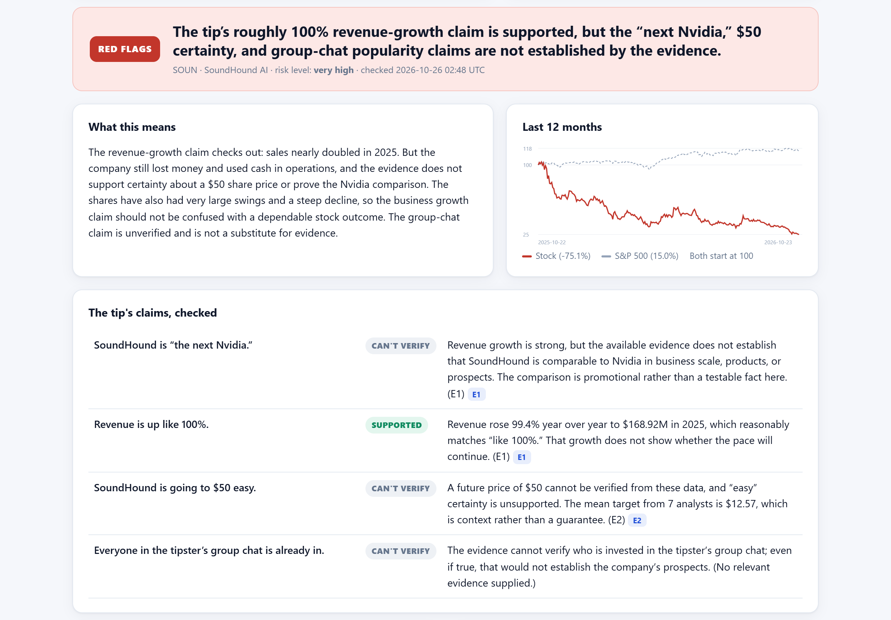

# TipCheck: check a stock tip before you bet on it

TipCheck is for everyday investors who hear stock tips from friends, group chats, Reddit, or TikTok. Paste the tip and a team of four
AI agents breaks it into claims, argues both sides using real price data and SEC filings, and tells you which
claims hold up, what the tip left out, and which red flags to watch for. It explains; it never tells you to buy or sell.



## Run it (about 3 minutes)

**Easiest:** double-click `start_mac.command` (Mac) or `start_windows.bat` (Windows). The first run creates `.env` for your key and installs everything; after that it starts the app and opens your browser.

**Or by hand:**

You need **Python 3.11+** and internet access (for Yahoo Finance + SEC data and the AI model).

```bash
git clone https://github.com/MichaelZ1212/tipcheck.git
cd tipcheck
python -m venv .venv
# macOS / Linux:
source .venv/bin/activate
# Windows (PowerShell):
#   .venv\Scripts\Activate.ps1
pip install -r requirements.txt
python run.py
```

Your browser opens **http://127.0.0.1:8000**. Click an example chip (e.g. "Group-chat hype") and press **Check this tip**.
A check takes about 30-90 seconds.

### API key
The app reads `PORTKEY_API_KEY` (course key, model `gpt-6-luna`) from a `.env` file. It looks in **this folder first,
then the folder above it**, so a shared `submissions/.env` works without copying anything. See `.env.example`.
If only `OPENAI_API_KEY` is set, it calls OpenAI directly instead.

### Market data and the offline sample
Live data comes from Yahoo Finance (via `yfinance`) and SEC EDGAR. Neither needs a key. If Yahoo is rate-limiting or you
are offline, TipCheck falls back to the bundled snapshot in `data/sample/` (tickers: SOUN, GME, COST, TSLA, NVDA,
PLTR, AAPL, AMC + SPY). The app marks results that used snapshot data.

- Force offline data only: add `DATA_MODE=sample` to `.env`
- Refresh the snapshot: `python scripts/build_sample.py`

## How it works

```
tip ─▶ pre-screen (code) ─▶ Intake agent ─▶ ticker check ─┬─▶ Bull analyst ─┐  (parallel, shared evidence)
                                                          └─▶ Bear analyst ─┤
                                     number grounding (code) ◀──────────────┘
                                                 ─▶ Judge agent ─▶ grounding + advice filter (code) ─▶ report
```

| Agent | Job | Tools | Output |
|---|---|---|---|
| Intake | Turn the tip into ≤6 checkable claims, spot pressure tactics and AI-directed text | none | `TipIntake` |
| Bull analyst | Strongest *honest* case for the stock | price performance, company snapshot, SEC financials, news | `AnalystCase` |
| Bear analyst | Strongest *honest* case against | same tools | `AnalystCase` |
| Judge | Verdict for every claim, red flags, what was left out, questions to ask | percent-change calculator | `TipReport` |

All agents use PydanticAI on the OpenAI Responses API via Portkey (`gpt-6-luna`). Stable instructions come first and carry a
prompt-cache breakpoint, so repeat calls bill them at the cached rate.

## Safety
- **Prompt injection:** the tip and news headlines are fenced as untrusted data; a code scanner flags AI-directed text;
  injected headlines are withheld before any agent sees them; tools are read-only and locked to the run's ticker.
- **Made-up numbers:** every number an agent writes is checked against the evidence it fetched; unmatched numbers are
  removed from the report and flagged.
- **No financial advice:** buy/sell sentences are stripped in code.
- **Overspending:** per-agent request/token/tool-call limits, a per-check dollar cap (live meter in the UI), a daily cap
  (`DAILY_BUDGET_USD`), a rate limit per visitor, and a 3-minute timeout. Closing the tab cancels the run.

## Tests and evaluation
```bash
python -m pytest -q          # offline tests (fake model, no API cost): pipeline, injection, grounding, budget
python scripts/eval.py       # real runs on 7 tips (hype / sensible / attack), Quick vs Thorough -> data/eval/
```

## Building the report and slides (for the author)
```bash
python scripts/build_sample.py                  # 1. offline data snapshot (internet, no key)
python scripts/eval.py                          # 2. 28 real checks -> data/eval/ (about $0.05-0.10)
python run.py                                   # 3. in a second terminal, keep the app running
pip install playwright                          #    (uses your installed Edge/Chrome)
python scripts/screenshots.py                   # 4. all screenshots -> docs/screenshots/ (4 real checks)
#   5. edit docs/report_config.json: repo link, real-user test, minutes to check a tip by hand
python scripts/build_report.py                  # 6. -> report.html + slides.html (images embedded)
```
`build_report.py` only uses numbers from real runs; anything missing shows up as a yellow TODO box and in the console.

## Project layout
```
backend/   agents.py (agents + pipeline) · market_data.py · safety.py · tokenomics.py · schemas.py · main.py (API) · prompts/
frontend/  index.html · app.js · styles.css   (no build step)
data/      sample/ (offline snapshot) · runs/ (every check, saved as JSON) · eval/
scripts/   build_sample.py · eval.py · build_report.py
tests/     test_tipcheck.py
```

*TipCheck is an educational tool, not investment advice.*
